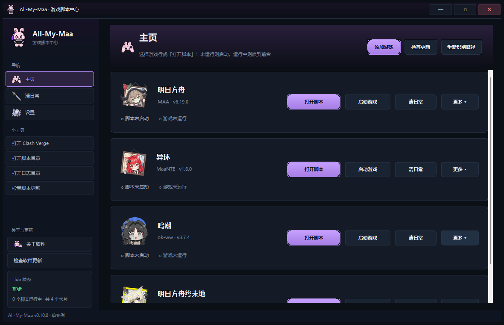
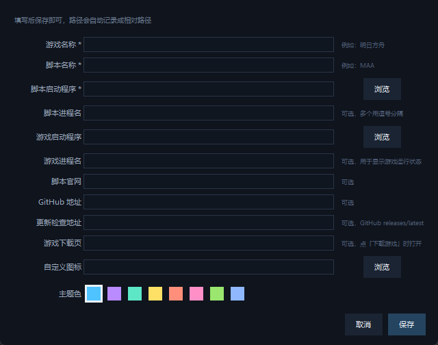

# All-My-Maa · 游戏脚本中心 v0.9.1

<p align="center">
  <a href="https://github.com/Diaohesi/All-My-Maa/releases/latest"></a>
  <a href="https://github.com/Diaohesi/All-My-Maa/actions/workflows/build-exe.yml"></a>
  <a href="https://github.com/Diaohesi/All-My-Maa/stargazers"></a>
  
  
  
  <a href="https://diaohesi.github.io/All-My-Maa/"></a>
</p>

**All-My-Maa（游戏脚本中心）** 是一个 Windows 桌面启动器：把 **明日方舟（MAA）**、
**异环（MaaNTE）**、**鸣潮（ok-ww）**、**明日方舟终末地（MaaEnd）** 等游戏脚本
收进同一个窗口，并且可以**可视化添加任意新游戏**。

一键启动脚本、启动游戏、打开游戏下载页、实时运行状态、版本检查与更新入口、
官网 / GitHub 直达、Clash Verge 快捷打开，还能自动识别脚本路径，换电脑、换盘符都能用。
从 v0.5.0 起，游戏启动程序支持**自动检测**：扫一遍注册表和常见安装目录，直接挑候选；
从 v0.6.0 起，游戏运行状态改为**复用各脚本自己的判断方法**（窗口类 / 标题正则、进程、可选 ADB），
能区分「运行中（窗口 / 进程 / ADB）」「启动器已开」「云游戏运行中」，启动器不再被误报成游戏运行。
从 v0.7.0 起，新增**一键清日常**：使用各脚本里已经配好的任务，按自定义顺序串行跑完多款游戏的日常；
同时修复鸣潮「只打开启动器」的问题，「启动脚本」会直接运行 ok-ww 正式脚本。
从 v0.8.0 起，界面重构为**左侧导航 + 主页 / 清日常 / 设置三页**的按钮式启动器：
主页直接打开或唤出脚本，清日常页勾选游戏、逐行开始 / 停止，设置页可调整强调色、刷新间隔、
关闭行为与清日常默认值。
从 v0.9.0 起，界面做了整体美化：统一 **Microsoft YaHei UI 字体与字号、圆角 / 间距设计令牌**、
自绘 **5 态圆角按钮**，窗口可**自由缩放**（默认 1180×760、最小 1000×640），页面滚动 / 换行；
侧边栏新增「**小工具**」（Clash / 脚本目录 / 日志目录 / 检查脚本更新）与「**关于与更新**」
（关于软件、检查软件更新）。
从 v0.9.1 起，应用图标换成 **品牌图标 LinYuxia**，并为四个子页面配上图标：
主页（手柄）、清日常（剑）、设置（雪花）、关于（角色头像），显示在窗口 / 任务栏、
侧边栏品牌、导航、页面标题与关于对话框。

**在线主页（GitHub Pages）**：<https://diaohesi.github.io/All-My-Maa/>
— 截图、功能一览和下载入口都在这一页。



<p align="center">
  
</p>

## 下载

- 想先了解再下载？逛一下
  [在线主页（GitHub Pages）](https://diaohesi.github.io/All-My-Maa/)，
  截图、功能和下载入口都在一页里。
- **推荐**：到 [Releases](https://github.com/Diaohesi/All-My-Maa/releases) 下载
  打包好的 `GameHub.exe`，放到 `GameHub/` 文件夹里双击 `启动游戏中心.bat` 即可，
  **不需要安装 Python 和 Pillow**。
- 源码运行 / 自己打包：

  ```bat
  git clone https://github.com/Diaohesi/All-My-Maa.git GameHub
  cd GameHub
  python -m pip install pillow
  ```

- 问题反馈：[Issues](https://github.com/Diaohesi/All-My-Maa/issues)


## 功能

| 功能 | 说明 |
| --- | --- |
| 左侧导航三页 | 侧边栏分区：导航「主页 / 清日常 / 设置」、小工具、关于与更新；当前页高亮 |
| 按钮式启动器 | 主页每个游戏一行：未运行「打开脚本」、运行中「唤到前台」；自绘圆角按钮 5 态（默认 / 悬停 / 按下 / 禁用 / 主按钮），点图标 / 名称同样生效 |
| 启动游戏 | 每行都有「启动游戏」按钮；未配置启动程序时自动检测候选，之后记住路径与进程名 |
| 鸣潮直接启动正式脚本 | `ok-ww.exe` 只是 PyAppify 启动器 / 更新器；「打开脚本」直接运行 bundled `pythonw.exe` + `working\main.py`，「更新」仍走启动器 |
| 游戏启动程序自动检测 | 编辑卡片时点「自动检测」，扫描注册表卸载项与常见安装目录，按匹配度列出候选（名称 + 路径 + 来源） |
| 下载游戏 | 行内「更多 ▾」→「游戏下载页」直达官方下载页；可在编辑里改成任意链接 |
| 游戏运行检测 | 复用各脚本自身的判断方法：窗口类 / 标题正则 + 进程（路径收窄）+ 可选 ADB；区分「运行中（窗口 / 进程 / ADB）」「启动器已开」「云游戏运行中」「未运行 / 未配置」，按设置页刷新间隔（1.0 / 1.5 / 2.0 秒）刷新 |
| 自定义检测规则 | 编辑卡片可填窗口类正则、窗口标题正则、进程名、ADB 包名；留空则使用脚本自动规则 |
| 一键清日常 | 清日常页勾选游戏后「开始选中项」按顺序串行；也可点每行「开始清日常」单独执行 |
| 清日常勾选与独立状态 | 勾选状态保存到 `daily.enabled`，↑↓ 顺序保存到 `daily_order`；每行独立「开始 / 停止」与独立状态（空闲 / 启动中 / 运行中 / 已完成 / 失败 / 超时 / 已停止） |
| 设置页 | 外观、启动器、路径、清日常、关于与更新五组；保存后立即生效并写入 `config.json` |
| 关于软件 | 版本、GitHub、项目主页、License、更新日志（最新版本在最上面），底部可直接检查软件更新 |
| 软件更新 | 读取 GitHub latest release，与本地版本比较并显示更新说明；只提供「打开发布页」，不自动下载 / 安装 |
| 自由缩放 | 默认 1180×760、最小 1000×640，窗口自由缩放；页面滚动、内容换行，不出现横向溢出 |
| 统一视觉 | 统一 Microsoft YaHei UI 字体与字号、圆角 12 / 8、间距 8–24、深色分层配色 |
| 品牌与页面图标 | 窗口 / 任务栏与侧边栏品牌用 `LinYuxia.png`；主页 / 清日常 / 设置 / 关于分别用手柄 / 剑 / 雪花 / 头像图标；缺失时自动回退 |
| 更新检查 | 小工具「检查脚本更新」检查各脚本版本并高亮更新；「关于与更新」检查 Hub 自身 GitHub latest 版本 |
| 更新 | 点「更新」打开对应脚本，让它走自己的更新流程（脚本自更新最安全） |
| 可视化添加游戏 | 顶部「添加游戏」填写名称、脚本路径、游戏路径、官网/下载链接、主题色即可生成游戏行 |
| 编辑 / 删除 | 行内「更多 ▾」→ 编辑卡片 / 删除（内置卡片不可删除，可修改） |
| 官网 / GitHub | 行内「更多 ▾」菜单一键打开项目主页与仓库 |
| 滚动列表 | 主页按行列出所有游戏，超过一屏可滚动，支持任意数量自定义游戏 |
| 路径自动识别 | 配置优先 → 自动扫描脚本目录 → 预期位置；「重新识别路径」可一键重扫 |
| 可移植 | 路径保存为相对路径，整个文件夹换电脑 / 换盘符后仍可用 |
| 小工具 | 侧栏一键打开 Clash Verge / 脚本目录 / 日志目录；「检查脚本更新」一键检查所有脚本 |
| 深色界面 | Windows 深色标题栏，统一设计令牌 + 自绘圆角控件，单实例运行 |

## 快速开始

1. 安装 [Python 3.10+](https://www.python.org/downloads/windows/)（勾选
   **Add python.exe to PATH**）。
2. 安装依赖（只需一次）：

   ```bat
   python -m pip install pillow
   ```

3. 把本仓库解压到脚本软件所在目录旁边，例如：

```
D:\All MAA\
├─ GameHub\                     ← 本程序（仓库根目录）
├─ MAA-v6.19.0-win-x64\         ← 明日方舟 MAA
├─ MaaNTE\                      ← 异环 MaaNTE
├─ WuwaMAA\ok-ww\               ← 鸣潮 ok-ww
└─ MaaEnd-win-x86_64-v2.33.0\   ← 明日方舟终末地 MaaEnd
```

4. 双击 `启动游戏中心.bat`；想放到桌面就双击 `创建桌面快捷方式.bat`。

> 脚本目录名不需要固定：Hub 会在自己所在目录里按 exe 文件名自动查找
> `MAA.exe` / `MaaNTE.exe` / `ok-ww.exe` / `MaaEnd.exe`，版本号目录名变了也能找到。
> 脚本放别处的话，可以在 `config.json` 里设置 `"root": "D:/其他/脚本目录"`。

### 打包成免 Python 的单文件 exe（可选）

在装有 Python 的机器上双击 `tools\build_exe.bat`，会生成 `dist\GameHub.exe`。
把它复制到 `GameHub\` 文件夹里，之后双击 `启动游戏中心.bat` 会优先运行它，
**目标电脑不需要安装 Python 和 Pillow**。

## 使用说明

### 添加一个新游戏

1. 点顶部 **「添加游戏」**；
2. 填写：
   - **游戏名称** / **脚本名称**（显示在主页行上）
   - **脚本启动程序**（必填，.exe；行内「打开脚本」用它）
   - **脚本进程名**（可留空，默认取 exe 文件名，用于识别运行状态）
   - **游戏启动程序**（可选；「启动游戏」按钮用，不填首次点击会让你选）
   - **游戏进程名**（可选，用于显示游戏运行状态）
   - **官网 / GitHub / 更新检查地址 / 下载页**（可选，行内链接与更新检查用）
   - **主题色**（8 种预设）
   - **自定义图标**（可选，png/ico，会自动复制到 `user_icons/`）
3. 保存后会立刻生成游戏行并写入 `config.json`。

内置的 4 个游戏也可以点行内「更多 ▾」→「编辑卡片」修改名称、路径、下载页等。

### 游戏启动程序自动检测（v0.5.0）

「游戏启动程序」不用再手动翻文件夹：

1. 行内「更多 ▾」→「编辑卡片」，在「游戏启动程序」旁点 **「自动检测」**；
2. Hub 会扫描 **注册表卸载项**（HKLM / HKCU，含 WOW6432Node）和常见安装目录
   （`Program Files`、`Program Files (x86)`、`LOCALAPPDATA\Programs`、
   各盘 `Games` / `Game` / `游戏` 等目录），按匹配度排序，列出带来源标注
   （`注册表` / `常见目录`）的候选；双击候选或选中后点「确定」即可填入；
3. 直接点主页行内的「启动游戏」时，如果还没配置启动程序，Hub 也会先自动检测：
   有候选弹出同一个选择框（也可以点「浏览…」手动选），没有候选则打开文件选择框。

检测总预算 1.8 秒，本机实测每款游戏约 0.2–0.4 秒。内置四款游戏自带关键词；
自定义游戏会按你填写的游戏名作为关键词扫描。本机示例（仅供参考）：
明日方舟 → `MuMuNxMain.exe`，异环 → `NTELauncher.exe`，
鸣潮 → `Wuthering Waves.exe`，终末地 → `Endfield.exe`。

### 游戏运行检测（v0.6.0）

v0.5 及更早只按进程名判断游戏是否在运行，内置配置甚至把启动器进程（`NTELauncher.exe` /
`Launcher.exe`）当成了游戏进程，于是「启动器开着」也会显示「运行中」。v0.6.0 改为
**复用每个脚本自己的判断方法**：

- **一次窗口快照**：`EnumWindows` 枚举顶层窗口，记录窗口类、标题、客户区、PID（本机约 8–14ms）；
- **窗口规则**：窗口类正则 + 标题正则（可只填其一），默认过滤 100×100 以下的小窗；
  允许最小化、同名多窗口、标题带尾随空格；
- **进程规则**：进程名 + 路径正则收窄（避免 `Client-Win64-Shipping.exe` 这类通用名误报），
  读不到进程路径时自动降级为「窗口类 + 标题」或进程名判定；
- **可选 ADB**：模拟器 / 云端包名规则，默认关闭（避免每次轮询拉起 adb 进程），
  需要时可在代码里调用 `gamehub.detector.set_adb_enabled(True)` 开启；
- **只做文案、不算运行**：启动器（`launcher`）与云游戏（`cloud`）单独匹配，
  分别显示「启动器已开」「云游戏运行中」，不会让「游戏运行中」误亮。

各内置脚本的规则来源：

| 脚本 | 规则来源 |
| --- | --- |
| MaaNTE（异环） | 直接读 `MaaNTE/interface.json` 的 `controller[].win32`（class_regex / window_regex），脚本更新自动跟随；内置兜底 `UnrealWindow` + `^\s*(异环\|NTE)\s*$` |
| MaaEnd（终末地） | 同样读 `interface.json` 的 `controller[].win32`；兜底 `UnityWndClass` + `Endfield` |
| ok-ww（鸣潮） | 照其 `config.py` 的做法：`UnrealWindow` + `Client-Win64-Shipping.exe` 双重校验（不强制标题） |
| MAA（明日方舟） | PC 客户端 `UnityWndClass` + `^明日方舟\|^Arknights`；模拟器模式为 ADB 包名规则（默认关闭） |

状态文案共 7 种：**运行中（窗口）/ 运行中（进程）/ 运行中（ADB）/ 启动器已开 /
云游戏运行中 / 未运行 / 未配置**。想自己校准？行内「更多 ▾」→「编辑卡片」，
「检测规则（可选）」里可以填**窗口类正则、窗口标题正则、进程名、ADB 包名**，
留空则继续使用脚本自动规则；「自动检测」选中游戏启动程序后也会带出脚本自带的规则建议。
检测实现与逆向依据见 [docs/game-detection-research.md](docs/game-detection-research.md)。

### 界面与体验（v0.9.1）

v0.8 的三页结构保留，v0.9 重做了视觉与响应式布局：

- **统一设计令牌**（`gamehub/theme.py`）：统一 **Microsoft YaHei UI** 字体，标题 21 / 页面 16 /
  名称 13 / 正文 11 / 辅助 10（最小 10 号）；圆角 12 / 8；间距 8 / 12 / 16 / 20 / 24；
  深色 surface 分层色板 + 柔和 1px 描边，去掉过小字号与紧贴的直角。
- **自绘圆角控件**：按钮、面板、输入框都是圆角自绘控件。按钮有 **5 态**
  （默认 / 悬停 / 按下 / 禁用 / 主按钮强调色），统一焦点描边与禁用置灰；主按钮跟随强调色。
- **自由缩放与响应式**：窗口默认 **1180×760**、最小 **1000×640**，可自由拖动缩放；
  侧边栏固定 232px，内容区自适应；主页 / 清日常 / 设置三页都支持滚动与换行，
  窗口变窄也不会横向溢出；对话框自动居中并限制在主窗口范围内。
- **左侧导航**：Logo + All-My-Maa / 游戏脚本中心；分区「导航」（主页 / 清日常 / 设置）、
  「小工具」、「关于与更新」；当前页高亮，底部显示 Hub 状态、运行数与版本（单实例运行）。
- **品牌与页面图标**：主窗口 / 任务栏与侧边栏品牌使用 `assets/LinYuxia.png`；导航与页面标题
  分别显示主页（手柄）、清日常（剑）、设置（雪花）图标，「关于软件」按钮与关于对话框显示
  角色头像（`page_about.png`）。图标缺失时品牌回退 `hub.png`、关于回退 `LinYuxia` / `hub.png`，
  其它图标缺失时正常显示文字；资源从 `assets/`（打包版 `_MEIPASS/assets`）加载。
- **主页**：更大的游戏行（图标 / 名称 / 版本 / 脚本状态 / 游戏状态）。行内按钮：
  **「打开脚本」**（未运行则启动，已在运行时变成 **「唤到前台」**）、**「启动游戏」**、
  **「清日常」**、**「更多 ▾」**（编辑卡片、检查更新、脚本官网、GitHub、游戏下载页、
  打开脚本文件夹、更新启动器、删除自定义卡片）。点行图标或名称等同「打开脚本」；
  右上角还有「添加游戏 / 检查更新 / 重新识别路径」。
- **清日常页 / 设置页**：逻辑不变，只做视觉统一与更大间距（详见下两节）。

### 设置（v0.9.0）

「设置」页分五组，改完点右上角 **「保存设置」** 后写入 `config.json` 顶层 `settings` 并立即生效
（目录不可写时会提示保存失败）：

- **外观**：强调色（8 种预设），应用到导航高亮与主按钮；
- **启动器**：启动时检查更新（默认开）、状态刷新间隔（1.0 / 1.5 / 2.0 秒）、
  关闭窗口行为（退出程序 / 最小化到任务栏）；
- **路径**：脚本根目录展示与「重新识别」、Clash Verge 可执行文件（浏览 / 自动查找）；
- **清日常**：默认超时（1–600 分钟，仅用于未单独设置超时的条目）、执行前显示命令预览、
  启用 ADB 检测（模拟器内游戏，默认关闭）、完成后结束脚本默认值；
- **关于与更新**：版本、关于软件、检查软件更新、更新日志、GitHub、项目主页入口。

### 小工具 / 关于 / 软件更新（v0.9.0）

**侧边栏「小工具」**

- **打开 Clash Verge**：一键打开 / 切到 Clash Verge，方便访问 GitHub 与脚本官方 API；
- **打开脚本目录**：打开 Hub 使用的脚本根目录（设置里的「脚本根目录」）；
- **打开日志目录**：打开 Hub 的 `logs/`（没有时回退程序目录），排查清日常 / 启动问题用；
- **检查脚本更新**：一次检查所有游戏脚本的最新版本，卡片 / 行内会高亮「更新」。

**关于软件**

侧边栏「关于与更新」→「关于软件」打开对话框：显示 All-My-Maa 版本、License、GitHub /
项目主页 / License / 更新日志入口，并预览 CHANGELOG 的「最近更新」（**最新版本在最上面**）；
底部可以直接「检查软件更新」。

**软件更新**

「关于与更新」→「检查软件更新」会读取 GitHub 仓库的 latest release
（`api.github.com/repos/Diaohesi/All-My-Maa/releases/latest`），与本地版本比较：

- 有新版本时显示「发现新版本：vX.Y.Z」+ 该版本的更新说明，可点「打开发布页」；
- 已是最新时显示「已是最新版本」；
- **本程序不会自动下载或安装更新**，下载 / 覆盖请到 Releases 页面手动完成；
- 网络不可用或 GitHub API 失败时会提示「检查软件更新失败…（请检查网络或代理）」。

> 小工具里的「检查脚本更新」检查的是**各游戏脚本**的版本（MAA / ok-ww / MaaNTE / MaaEnd），
> 而「检查软件更新」检查的是 **Hub 自身**的版本，两者互不影响。

### 一键清日常（勾选 + 独立状态）

左侧导航进入 **「清日常」** 页：勾选要跑的游戏，按顺序串行执行，每一行都有自己的
开始 / 停止按钮与独立状态。主页每行的「清日常」按钮也可以单独跑当前游戏。
v0.9.0 起这一页做了视觉统一（圆角面板、更大按钮与间距、5 态按钮），勾选 / 独立状态逻辑不变。

**前置条件（先在脚本里准备好）**

- **鸣潮 ok-ww**：在 ok-ww 界面里配置好「每日任务」（`DailyTask`）并保存；Hub 会用
  `pythonw.exe main.py -t DailyTask -e` 直接执行，任务完成后脚本自行退出。
- **明日方舟 MAA**：在 MAA 里勾选日常任务队列（建议单独建一个「日常」配置），并在
  MAA 设置 → 热键里配置 **LinkStart（开始任务）** 热键；Hub 会带 `--skip-startup-auto-run`
  启动 MAA，等窗口 / 日志就绪后自动发送这个热键。MAA 已经在运行时，Hub 只发热键、不接管进程。
- **异环 MaaNTE / 终末地 MaaEnd**：在 MXU 里准备好实例（本机示例：「挂机任务」/「全套日常」），
  并在清日常页对应行内填写**实例名**。MaaEnd 的实例带「启动游戏」前置任务时会自动拉起游戏；
  MaaNTE 的实例如果没有该前置任务，**请先点主页「启动游戏」再执行清日常**。

**怎么用**

1. 打开左侧「清日常」页：列表里每行对应一个游戏，**勾选框**决定它是否加入队列
   （勾选状态保存到 `config.json` 的 `daily.enabled`）；
2. 点选一行后可用工具栏「↑ 上移 / ↓ 下移」调整顺序（保存到 `daily_order`）；
   行内可以直接填写 MXU 实例名 / ok-ww 任务名 / MAA 配置 / 超时（1–600 分钟）/ 额外参数，
   点「保存设置」生效；
3. 「开始选中项」按勾选顺序串行执行；也可以点每行自己的「开始清日常」只跑这一项。
   **每行有独立的开始 / 停止按钮和独立状态**（空闲 / 启动中 / 运行中 / 已完成 / 失败 / 超时 /
   已停止）；同一时刻只运行一项，其它行会保持自己的状态并提示「另一项清日常进行中」；
4. 「查看命令(dry-run)」可以在不启动任何进程的情况下预览会执行的命令；
5. 点「停止」会结束**由 Hub 启动的**脚本进程（不会动你自己打开的程序；MAA 本来就在运行时
   只停止监控）。顶部工具栏还有「全选 / 取消全选」，运行日志显示在下方日志面板。

**每款游戏的执行方式与完成判定**

| 游戏 | Hub 实际执行 | 完成判定 | 默认超时 |
| --- | --- | --- | --- |
| 鸣潮 ok-ww | `pythonw.exe "<working>\main.py" -t DailyTask -e`（cwd=working，管理员） | 进程退出 + 日志出现 `Successfully Executed Task, Exiting Game and App!` | 90 分钟 |
| 明日方舟 MAA | `MAA.exe --skip-startup-auto-run [--config "<配置名>"]` → 就绪后发送 LinkStart 热键 | `MAA\debug\gui.log` 出现「任务已全部完成！」；失败「任务出错」、停止「已停止」 | 120 分钟 |
| 异环 MaaNTE | `MaaNTE.exe --autostart --instance "<实例名>" --quit-after-run` | MXU 进程退出（退出码不区分成败，按日志启发式判断） | 120 分钟 |
| 终末地 MaaEnd | `MaaEnd.exe --autostart --instance "<实例名>" --quit-after-run` | MXU 进程退出 | 150 分钟 |

**超时、停止与失败处理**

- 每项都有独立超时（默认见上表，可改）；超时会结束**本次启动的进程**并记为「超时」，然后继续下一项；
- 队列是**串行**的：四款脚本都要抢占鼠标 / 前台，一次只跑一个；单项失败不会中断后面的项，
  结束时汇总「完成 X / 总数、失败 / 停止」；
- 每一项都以管理员权限启动（`ShellExecuteW` + `runas`），Windows 会**逐项弹 UAC**，点「是」继续；
  点「否」则该项记为失败；
- 失败先看清日常页日志面板的原因，再对照日志：ok-ww 是 `working\logs\ok-script.log`，
  MAA 是 `debug\gui.log`；修好实例 / 任务 / 热键后重跑即可。

> ⚠ **账号风险**：清日常调用的是脚本自身的自动化能力，可能违反游戏条款、存在账号风险；
> 执行期间脚本会抢鼠标键盘、切换前台窗口，请不要操作电脑。是否使用、使用哪款脚本请自行判断并承担风险；
> 本工具只负责按顺序调用，不修改游戏文件、不注入进程。

### 鸣潮启动修复（v0.7.0）

以前点鸣潮的「启动脚本」，只会打开 ok-ww 的启动器。原因有两层：

- `ok-ww.exe` 是 **PyAppify 启动器 / 更新器**，不是脚本本体；真正的脚本是
  `<ok-ww>\data\apps\ok-ww\working\main.py`，由随包附带的
  `<ok-ww>\data\apps\ok-ww\python\pythonw.exe` 运行；
- 旧配置把 `script_exe` 指向 `ok-ww.exe`、`script_procs` 写成 `OK-WW.EXE`，
  于是「脚本运行中」也会误判。

v0.7.0 起，Hub 为鸣潮生成**启动规格**（`launch`，type=python）：直接启动
`pythonw.exe main.py`（cwd=working，清理 `PYTHON*` 环境、注入 `PYAPPIFY_*`），
脚本目录不完整时自动回退启动器并提示；「更新」仍然打开 `ok-ww.exe` 走它自己的更新流程。
脚本运行状态改为按 `pythonw.exe` 的**完整路径**判定（不认同名 python，也不把启动器算作脚本）。
启动规格会保存到 `config.json`，其它脚本也可以用同样的 python 启动规格。

### 原理小结：四款脚本是怎么被自动执行的

- **MAA / MaaFramework**：MAA GUI（WPF）+ MaaCore 自动化核心，任务是「识别 → 动作」的 pipeline；
  启动用任务队列 + `LinkStart` 热键触发；
- **MXU（MaaNTE / MaaEnd）**：Tauri + React 的通用 GUI，读取符合 PI V2 的 `interface.json`，
  内嵌 MaaFramework，官方支持 `--autostart --instance "<实例名>" --quit-after-run` 自启动执行；
- **ok-script / ok-ww**：Python + PySide6 自动化框架，任务可被命令行 `-t <任务名> -e` 指定，
  完成后退出并关闭游戏；ok-ww 官方计划任务也是这么调用的；
- **PyAppify**：Rust / Tauri 启动器 + 更新器，负责把 Python 与脚本装到 `data/apps/<app>/`，
  运行时以 `working` 为 cwd 拉起 `pythonw.exe main.py`。

更完整的逆向与实验记录（窗口规则、CLI 参数、完成信号、风险点）见
[docs/daily-automation-research.md](docs/daily-automation-research.md)。

### 更新是怎么做的

Hub 只负责**检查和提醒**，真正的文件更新由脚本自己完成（MAA 启动时检查更新、
ok-ww 启动即自动更新、MaaNTE / MaaEnd 启动后自检更新）。点「更新」时，如果检测到
新版本会打开脚本让它更新；已是最新会直接提示，不会白启动。

### 路径与配置

`config.json`（已 gitignore）示例：

```json
{
  "version": 4,
  "apps": {
    "maa": {
      "script_exe": "MAA-v6.19.0-win-x64/MAA.exe",
      "game_exe": "D:/Games/Arknights/launcher.exe",
      "script_procs": ["MAA.EXE"],
      "game_procs": ["ARKNIGHTS.EXE"],
      "daily": {
        "enabled": true,
        "config": "",
        "timeout_min": 120,
        "close_after": false
      },
      "download": "https://ak.hypergryph.com/",
      "accent": "#4fc3ff"
    }
  },
  "custom_apps": [
    {
      "key": "custom_1",
      "game": "我的游戏",
      "script": "MyScript",
      "script_exe": "MyScript/run.exe",
      "game_exe": "",
      "detect": {
        "any_of": [
          { "type": "win", "class_re": "^UnrealWindow$",
            "title_re": "^\\s*我的游戏\\s*$", "min_client_size": [200, 120] },
          { "type": "proc", "names": ["MyGame.exe"] }
        ]
      },
      "detect_custom": true,
      "download": "https://example.com/download",
      "accent": "#ff8f7a"
    }
  ],
  "clash": "C:/Program Files/Clash Verge/clash-verge.exe",
  "daily_order": ["maa", "nte", "wuwa", "maaend"],
  "settings": {
    "accent": "#4fc3ff",
    "check_update_on_start": true,
    "refresh_interval": 1.5,
    "close_action": "exit",
    "clash_exe": "",
    "daily_default_timeout": 120,
    "daily_show_preview": true,
    "adb_enabled": false,
    "daily_close_after": true
  },

  "root": "可选：脚本所在目录（默认是 Hub 的上一级目录）"
}
```

- 路径优先保存为相对路径，因此整个文件夹搬走后依然有效；
- 手动选择过路径会记住，点「重新识别路径」可重新扫描；
- `detect` 是自定义检测规则（可选），`detect_custom: true` 表示不再使用脚本自动规则；
- `daily` 是每行的清日常设置：`enabled` 表示是否勾选加入队列，另有实例名 / ok-ww 任务名 /
  MAA 配置、超时、额外参数、完成后结束脚本；
- `daily_order` 是清日常队列顺序；`launch` 是启动规格（v0.7 自动为鸣潮生成
  `pythonw + main.py` 规格，旧配置会自动补齐）；
- `settings` 是 v0.8 顶层设置（强调色、启动检查更新、刷新间隔、关闭行为、Clash 路径、
  清日常默认值），保存后立即生效；
- 配置 v4 起，内置游戏的 `game_procs` 会迁移为游戏本体进程（旧配置里误填的启动器进程会被纠正）；
- 想恢复默认：删除 `config.json` 后重新打开即可。

## 目录结构

```
GameHub/
├─ hub.pyw                 程序入口
├─ gamehub/                主程序
│  ├─ ui.py                侧边栏三页、小工具、关于/软件更新、主页行、清日常页、设置页、对话框
│  ├─ render.py            Pillow 图标 / 旧版画布渲染
│  ├─ store.py             配置、路径识别、版本、进程、更新检查、游戏自动检测、启动规格、设置
│  ├─ detector.py          游戏运行检测（窗口 / 进程 / ADB 规则）
│  ├─ daily.py             一键清日常（计划 / 执行 / 独立状态 / 队列）
│  └─ theme.py             设计令牌（字体 / 字号 / 圆角 / 间距 / 深色配色、窗口尺寸）
├─ assets/                 图标资源
│  ├─ LinYuxia.png         品牌 / 窗口 / 侧边栏图标
│  ├─ page_home.png        主页图标（手柄）
│  ├─ page_daily.png       清日常图标（剑）
│  ├─ page_settings.png    设置图标（雪花）
│  ├─ page_about.png       关于图标（角色头像）
│  ├─ maa.png / nte.png / wuwa.png / maaend.png  内置脚本图标
│  └─ hub.png / hub.ico / custom.png             窗口回退 / 占位图标
├─ tools/                  开发工具（运行时不需要）
│  ├─ make_assets.py       生成程序图标 / 占位图标
│  ├─ extract_icons.py     从本地脚本提取图标
│  ├─ build_exe.bat        PyInstaller 打包
│  ├─ create_shortcut.ps1  创建桌面快捷方式（由根目录 bat 调用）
│  ├─ grab_hub.py          后台截取窗口（调试 / 文档截图）
│  ├─ preview.py           截图小工具（调试）
│  ├─ test_detect.py       游戏启动程序自动检测命令行自测
│  ├─ test_detect_game.py  游戏运行状态检测命令行自测
│  ├─ test_daily.py        一键清日常自测（mock，不启动脚本）
│  ├─ test_launch_spec.py  启动规格自测（--live 只读核对本机 ok-ww）
│  ├─ test_ui_state.py     新 UI 状态逻辑自测（per-app 状态 / 勾选 / settings）
│  ├─ regression_test.py   回归测试（标准库 unittest）
│  └─ verify_exe.ps1       本地打包 exe 验证
├─ docs/                   文档与 GitHub Pages 站点
│  ├─ index.html           项目主页
│  ├─ site.css             主页样式
│  ├─ assets/              主页用图片（截图 / logo）
│  ├─ screenshot.png       界面截图
│  ├─ add-dialog.png       添加游戏对话框截图
│  ├─ qa-report.md         回归测试报告
│  ├─ game-detection-research.md  游戏检测机制调研报告
│  └─ daily-automation-research.md 清日常 / 启动链调研报告
├─ .github/                GitHub 维护配置
│  ├─ workflows/build-exe.yml   自动打包 GameHub.exe / 发布 Release
│  ├─ workflows/pages.yml       自动部署 docs/ 到 GitHub Pages
│  └─ ISSUE_TEMPLATE/bug_report.yml
├─ 启动游戏中心.bat
├─ 创建桌面快捷方式.bat
└─ README.md / CHANGELOG.md / LICENSE / .gitignore / requirements.txt
```

## 二次开发

- 界面在 `gamehub/ui.py`（侧边栏 + 主页 / 清日常 / 设置三页，真实 Tk 控件 + 自绘圆角控件）；
  设计令牌在 `gamehub/theme.py`（`UI_FONT` / `UI_FONT_SIZES` / `RADIUS` / `SPACE_*` / `UI_*` 色板、
  `WIN_W/WIN_H` / `MIN_W/MIN_H` / `SIDEBAR_W`），改视觉先改令牌；`RoundButton`（5 态）/
  `RoundPanel` / `RoundEntry` 在 `ui.py`，图标渲染在 `gamehub/render.py`。
- 小工具 / 关于 / 软件更新在 `ui.py`：`open_script_dir` / `open_log_dir` / `open_about` /
  `check_software_update`；软件更新解析在 `parse_release_payload`（GitHub latest release，
  版本比较用 `store.version_key` / `is_newer`），只打开发布页、不自动下载。
- 更新日志渲染在 `format_changelog_text`（把 CHANGELOG 转纯文本，保持最新版本在最上面），
  关于对话框与「更新日志」窗口共用；相关纯逻辑在 `tools/test_ui_state.py` 有自测。
- 设置项在 `gamehub/store.py` 的 `DEFAULT_SETTINGS` / `_clean_settings`，设置页 UI 在
  `ui._build_settings_page`；新增设置项要同时改清洗、保存与界面。
- 清日常页的勾选 / 独立状态由 `gamehub/daily.py` 的 `DailyManager` 维护
  （`start_single` / `stop_single` / `start_queue` / `snapshot`），可运行
  `python tools/test_ui_state.py` 验证状态隔离与勾选逻辑。
- 游戏运行检测规则在 `gamehub/detector.py`（`BUILTIN_RULES` / `read_game_rules`）：
  MaaNTE / MaaEnd 优先读各自 `interface.json`，其余用内置规则；改完可运行
  `python tools/test_detect_game.py` 查看每行当前生效的规则与真实检测结果。
- 一键清日常在 `gamehub/daily.py`：`plan_for` 生成调用计划、`run` 执行单游戏、`DailyQueue` 串行队列；
  先用 `dry_run` 预览命令再执行。配置字段在 `gamehub/store.py`（`BUILTIN_DAILY` / `_clean_daily` /
  `daily_order`）；改完跑 `python tools/test_daily.py`（mock，不启动脚本）。
- 鸣潮启动规格在 `gamehub/store.py`（`build_okww_launch` / `launch_app` / `launch_running_pids`）；
  自测 `python tools/test_launch_spec.py`，加 `--live` 只读核对本机 ok-ww 安装。
- UI 图标：`gamehub/ui.py` 顶部 `BRAND_ICON_FILE` / `PAGE_ICON_FILES` / `ICON_SIZES` /
  `ICON_FALLBACKS` 定义品牌与四个页面图标，资源从 `store.ASSETS`（源码 `assets/`、
  打包版 `_MEIPASS/assets`）加载；替换同名 PNG 即可（建议 256×256 透明背景），
  缺失时品牌回退 `hub.png`、关于回退 `LinYuxia` / `hub.png`。
- 游戏卡片图标：行内「更多 ▾」→「编辑卡片」可指定自定义图标（会自动复制到 `user_icons/`）。
- 改完代码后重新截图：运行 Hub 后执行 `python tools/grab_hub.py docs/screenshot.png`。

## 常见问题

**Q: 提示缺少 Pillow？**
运行 `python -m pip install pillow`；或使用打包好的 `GameHub.exe`。

**Q: 提示“路径缺失”？**
点行内「更多 ▾」→「编辑卡片」选择脚本的 exe，或点「重新识别路径」重扫。
选择一次后会写入 `config.json`。

**Q: 游戏自动检测找不到启动程序？**
自动检测只认注册表卸载项与常见安装目录，绿色版 / 便携版 / 自定义安装位置可能扫不到。
先在候选框里点「浏览…」手动选择；或确认游戏已正常安装后，再在「编辑卡片」里点一次
「自动检测」重试。也可以直接把游戏启动程序的完整路径填进「游戏启动程序」。

**Q: 游戏已经启动，却显示「未运行」？**
1. 先确认不是只有启动器 / 云游戏在跑——它们只显示「启动器已开」「云游戏运行中」，不算游戏运行；
2. 行内「更多 ▾」→「编辑卡片」，在「检测规则（可选）」里补窗口类、窗口标题（正则）、进程名或 ADB 包名；
3. 游戏以管理员权限运行、Hub 是普通权限时，可能读不到进程路径，可尝试以管理员身份运行 Hub；
4. 云游戏客户端的窗口标题通常不是游戏本身，需要自定义窗口标题正则；
5. 终端运行 `python tools/test_detect_game.py` 可查看每行的规则来源与检测结果，便于排查。

**Q: 更新检查显示“无法检查”？**
GitHub / 官方 API 需要网络访问；点侧边栏「打开 Clash Verge」后点「检查更新」重试。
MaaNTE 官方 GitHub 仓库在部分网络下不可访问，此时 Hub 会改为直接打开
MaaNTE 让它自行检查更新。

**Q: 启动游戏选择错了？**
行内「更多 ▾」→「编辑卡片」，重新填写「游戏启动程序」，或删除 `config.json`
里对应字段后重新点击按钮选择。

**Q: 提示需要管理员权限？**
`ok-ww` 自身要求管理员权限；「一键清日常」每一项也会以管理员权限启动，可能逐项弹 UAC，点「是」继续。
若点「否」，该项会记为失败。

**Q: 点「清日常」没反应 / 一直没开始？**
先看清日常页下方日志面板的原因。常见情况：目标脚本已经在运行（需要先关闭）、MAA 热键读不到、
MXU 实例名为空或实例不存在、UAC 弹窗被点「否」。可先用「查看命令(dry-run)」确认调用参数。

**Q: 提示「任务未配置」/「实例不存在」？**
回到脚本里准备任务：ok-ww 在界面里配置并保存「每日任务」；MAA 勾选任务队列并配置 LinkStart 热键；
MaaNTE / MaaEnd 在 MXU 里建好实例（并在清日常页对应行内填写实例名）。改完再重试。

**Q: 清日常时脚本窗口弹在后台 / 抢鼠标？**
脚本本身需要前台输入（尤其 MaaNTE / MaaEnd 的 Win32-Front、ok-ww），执行期间请勿操作电脑；
需要中止时点「停止」。能否后台运行以脚本自身支持为准，Hub 只负责启动与等待。

**Q: 多个游戏顺序执行时中断了？**
单项失败 / 超时不会中断队列。看清日常页日志定位那一项（ok-ww 的 `working\logs\ok-script.log`、
MAA 的 `debug\gui.log`），修好后重跑队列即可；点「停止」只会结束由 Hub 启动的进程。

**Q: 一键清日常会被封号吗？**
清日常调用的是脚本自身已有的自动化能力，自动化风险由你自行承担；脚本协议与反作弊策略可能变化，
使用前请自行评估，不要用于违反游戏条款的场景。

**Q: 清日常入口在哪里？**
左侧导航「清日常」页：勾选游戏、调顺序、逐行开始 / 停止；主页每行的「清日常」按钮也可以
单独跑当前游戏。

**Q: 勾选了游戏，但「开始选中项」没执行？**
只有勾选的行才会加入队列（勾选状态保存到 `daily.enabled`）；确认至少勾选一项、且没有其它
清日常正在运行（同一时刻只运行一项），再看行内状态与日志面板的原因。可用
「查看命令(dry-run)」确认实际命令。

**Q: 状态不刷新 / 刷新太慢？**
设置 → 启动器 → 状态刷新间隔可选 1.0 / 1.5 / 2.0 秒；脚本刚启动时可能短暂显示「启动中」。
也可以点「检查更新」或切换页面触发刷新。

**Q: 设置保存后没生效？**
改完点右上角「保存设置」；强调色、刷新间隔、关窗行为会立即生效，清日常默认值只影响
尚未单独保存过设置的行。配置目录不可写时会提示「配置文件无法写入」。

**Q: 关闭窗口是最小化还是退出？**
设置 → 启动器 → 关闭窗口：可选「退出程序」或「最小化到任务栏」。

**Q: 窗口太小 / 文字看起来挤？**
v0.9 默认窗口 1180×760、最小 1000×640，直接拖动边缘就能放大；主页 / 清日常 / 设置页都支持
滚动，窗口变窄会自动换行，不会横向溢出。字体统一为 Microsoft YaHei UI，最小 10 号；
如果整体偏小，可在 Windows「显示设置 → 缩放」里调整系统缩放。

**Q: 软件更新一直失败 / 检查不出来？**
「检查软件更新」会访问 GitHub API，需要能访问 `api.github.com`；先点侧栏「打开 Clash Verge」
再重试。失败时提示「检查软件更新失败…（请检查网络或代理）」，也可能是 GitHub 限流，稍后再试。

**Q: 「检查脚本更新」和「检查软件更新」有什么区别？**
「检查脚本更新」（小工具）检查各游戏脚本的最新版本并高亮「更新」；
「检查软件更新」（关于与更新）只检查 **Hub 自身**的新版本，两者是独立的。

**Q: 软件更新会自动下载安装吗？**
不会。发现新版本只显示更新说明，并提供「打开发布页」；下载与覆盖由你手动在 Releases 页面完成。

**Q: 图标没显示 / 想换成自己的图标？**
v0.9.1 起窗口 / 任务栏与侧边栏品牌使用 `assets/LinYuxia.png`，主页 / 清日常 / 设置 / 关于使用
`assets/page_*.png`。图标缺失时品牌回退 `hub.png`、关于回退 `LinYuxia.png` / `hub.png`；
替换同名 PNG 即可（源码运行读 `assets/`，打包版读 exe 内的 `_MEIPASS/assets`）。

**Q: 访问 / 推送 GitHub 很慢或失败？**
先打开 Clash Verge，再给 git 设置一次本地代理即可：

```bat
git config --local http.proxy http://127.0.0.1:7897
git config --local https.proxy http://127.0.0.1:7897
```

（端口按 Clash Verge 实际设置调整；取消代理用 `--unset`。）

## 参与开发

- 欢迎提交 [Issue](https://github.com/Diaohesi/All-My-Maa/issues) 反馈问题或建议；
- 改动后先跑回归测试（标准库 `unittest`，不需要 pytest，全绿时退出码为 0）：

  ```bat
  python tools/regression_test.py   :: 回归测试（数量见 docs/qa-report.md）
  python tools/test_detect.py       :: 只验证游戏启动程序自动检测，不打开 GUI
  python tools/test_detect_game.py  :: 只读查看游戏运行状态检测（窗口 / 进程 / ADB）
  python tools/test_daily.py        :: 一键清日常自测（mock，不启动脚本）
  python tools/test_launch_spec.py  :: 启动规格自测（--live 只读核对本机 ok-ww）
  python tools/test_ui_state.py     :: 新 UI 状态逻辑自测（per-app 状态 / 勾选 / settings）
  ```

  详细结果、已知缺陷与未覆盖点见 [docs/qa-report.md](docs/qa-report.md)；
- Pull Request 前请先跑一遍 Hub，确认添加/编辑卡片、启动脚本、启动游戏等功能正常；
- 提交信息建议使用 `feat:`、`fix:`、`docs:` 等前缀。

## 发布新版本（维护者）

1. 修改 `gamehub/__init__.py` 中的 `VERSION`，并更新 `CHANGELOG.md`；
2. 提交并推送：`git add -A && git commit -m "release: vX.Y.Z" && git push`；
3. 打标签并推送：`git tag -a vX.Y.Z -m "All-My-Maa vX.Y.Z" && git push origin vX.Y.Z`；
4. GitHub Actions 会自动构建 `GameHub.exe` 并创建 / 更新对应的 Release
   （见 [.github/workflows/build-exe.yml](.github/workflows/build-exe.yml)）；
5. 改动了 `docs/` 里的主页内容时，推送后会自动部署到
   [GitHub Pages](https://diaohesi.github.io/All-My-Maa/)
   （见 [.github/workflows/pages.yml](.github/workflows/pages.yml)；
   仓库 Settings → Pages 的 Source 需为「GitHub Actions」）。

发布页：<https://github.com/Diaohesi/All-My-Maa/releases>

## 致谢与声明

本仓库代码使用 MIT License。各脚本软件（MAA / MaaNTE / ok-ww / MaaEnd）
及其图标版权归各自作者所有；本仓库不包含它们的程序文件。
`assets/` 中的图标是从本机已安装的脚本中提取 / 官方 logo，仅作为启动器展示素材，
公开分发前建议替换为自己的图标。
